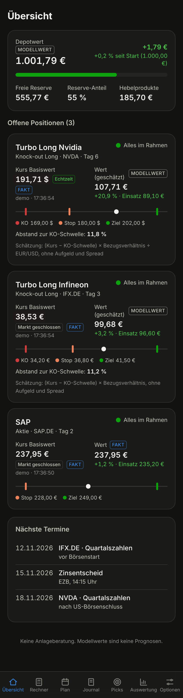
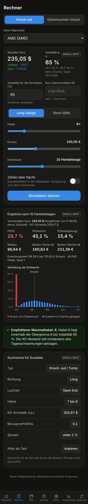
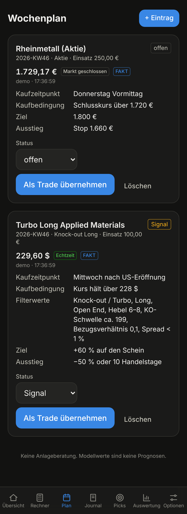
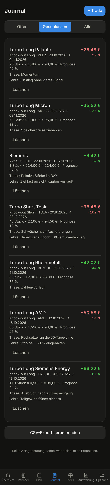
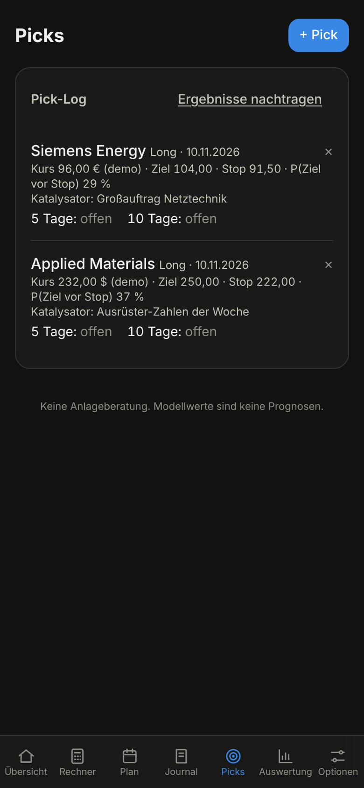
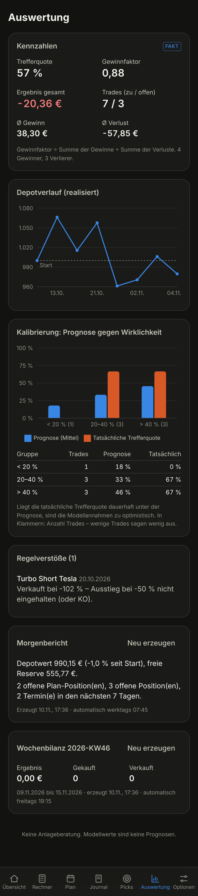
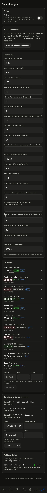

# Spaßdepot

Analyse- und Journal-Tool für kurzfristige Aktien- und Knock-out-Trades eines Privatanlegers
(Deutschland, Broker Scalable Capital, Depotgröße 1.000 €).

**Die App führt keine Orders aus und verbindet sich nicht mit dem Broker.** Sie liefert Live-Kurse,
Simulationen, Wahrscheinlichkeiten, Warnungen und Berichte. Keine Anlageberatung. Modellwerte sind
keine Prognosen.

| Übersicht | Rechner | Plan | Journal |
|---|---|---|---|
|  |  |  |  |

| Picks | Auswertung | Einstellungen |
|---|---|---|
|  |  |  |

Die Bildschirmfotos zeigen Beispieldaten mit dem Demo-Anbieter (simulierte Kurse, Quelle „demo“).

## Installation und Start

Voraussetzungen: Python 3.11+, Node.js 20+ (oder nur Docker).

```bash
cp .env.example .env        # Schlüssel eintragen (siehe unten)

# Variante 1: Docker
docker compose up

# Variante 2: lokal
make install
make dev
```

- Frontend: <http://localhost:5173> (am Handy: `http://<IP-des-Rechners>:5173`)
- Backend: <http://localhost:8000>, API unter `/api`, OpenAPI-Doku unter <http://localhost:8000/api/docs>
- Datenbank: SQLite unter `data/app.db` (wird beim ersten Start angelegt, Watchlist wird vorbefüllt)

Ohne Schlüssel ausprobieren: `PROVIDER_ORDER=demo` in `.env` setzen, starten und mit `make demo`
Beispieldaten anlegen. Der Demo-Anbieter erzeugt Zufallskurse – das sind keine Marktdaten.

### .env

| Variable | Bedeutung |
|---|---|
| `PROVIDER_ORDER` | Reihenfolge der Kursanbieter = Priorität. Standard `finnhub,twelvedata,yfinance,alphavantage`. Anbieter ohne Schlüssel werden übersprungen. |
| `FINNHUB_API_KEY`, `TWELVEDATA_API_KEY`, `ALPHAVANTAGE_API_KEY` | API-Schlüssel der Anbieter (alle optional; ohne Schlüssel läuft nur Yahoo). |
| `APP_PASSWORD` | Optionaler Passwortschutz (Login mit Session-Cookie). Leer = kein Login. Setzen, sobald die App nicht nur lokal läuft. |
| `SESSION_SECRET` | Zufallswert zum Signieren des Cookies. |
| `COOKIE_SECURE` | `1`, wenn die App über HTTPS ausgeliefert wird. |
| `DATABASE_URL` | Standard `sqlite:///data/app.db`. |

Schlüssel stehen nur in `.env`. `.env`, `data/` und Datenbankdateien sind in `.gitignore` ausgeschlossen.

## Kursanbieter

Stand der Bedingungen: November 2026. **Einschränkung:** Die Seiten der Anbieter waren aus der
Entwicklungsumgebung nicht direkt abrufbar; die Angaben stammen aus einer Websuche (überwiegend
Vergleichsseiten und Auszüge der Anbieterseiten) und sollten vor der Nutzung auf den verlinkten
Preisseiten gegengeprüft werden. Auch die Schnittstellen selbst konnten nur gegen gemockte Antworten
getestet werden, nicht gegen die echten Dienste.

| Anbieter | Kostenloser Zugang | Echtzeit im kostenlosen Zugang | Limits | Nutzung in der App | Nutzungsbedingungen |
|---|---|---|---|---|---|
| [Finnhub](https://finnhub.io/pricing) | ja, mit Schlüssel | US-Aktien (WebSocket-Trades und REST-Quote). Internationale Börsen wie Xetra nur in Bezahltarifen. | 60 Abfragen/Min, WebSocket bis 50 Symbole | 1. Wahl für US-Werte: Stream + Abfrage. Keine Tagesverläufe (Kerzen sind kostenpflichtig). | kostenloser Zugang nur für private, nicht-kommerzielle Nutzung |
| [Twelve Data](https://twelvedata.com/pricing) | ja („Basic“), mit Schlüssel | US-Aktien, Devisen, Krypto. Europäische Börsen (XETR) in Echtzeit erst im Pro-Tarif; WebSocket im Basic-Tarif nur für Testsymbole. | 8 Abfragen/Min, 800/Tag | EUR/USD, US-Werte, Tagesverläufe. Xetra wird versucht; lehnt der Tarif ab, wird das Symbol eine Stunde nicht mehr dort angefragt. | laut Anbieter; kommerzielle Nutzung nur in Bezahltarifen |
| Yahoo Finance (`yfinance`) | ja, ohne Schlüssel | je nach Börse verzögert (Xetra üblicherweise 15 Min; die Antwort nennt die Verzögerung, die App zeigt sie an) | nicht veröffentlicht; die App fragt höchstens alle 20 s je Symbol | Rückfallebene für alle Symbole, Tagesverläufe, Index für Risk-off | inoffizielle Schnittstelle, nur privater Gebrauch; kann jederzeit geändert oder gesperrt werden |
| [Alpha Vantage](https://www.alphavantage.co/premium/) | ja, mit Schlüssel | nein – nur Schlusskurs des Vortags | 25 Abfragen/Tag, 1/Sekunde | nur Tagesverläufe und Volatilität (`TIME_SERIES_DAILY` compact, `GLOBAL_QUOTE`), deutsche Aktien als `IFX.DEX`. Nie als aktueller Kurs. | laut Anbieter |

Praktische Folge: **Echtzeitkurse für deutsche Aktien gibt es mit kostenlosen Zugängen nicht.**
Xetra-Werte kommen ohne Bezahltarif über Yahoo und sind als „verzögert (15 Min)“ gekennzeichnet.

So arbeitet die Anbieter-Schicht:

- Gemeinsames Interface `PriceProvider` (`latest_price`, `daily_history`, `stream`) in `backend/app/data/base.py`.
- Reihenfolge aus `PROVIDER_ORDER`; fällt ein Anbieter aus, übernimmt der nächste. Nach drei Fehlern in
  Folge pausiert ein Anbieter (30 s, 60 s, … höchstens 10 Min).
- Ratenbegrenzung je Anbieter (Mindestabstand, Minutenfenster, Tageszähler). Der Tageszähler liegt in
  der Datenbank und übersteht Neustarts.
- Tagesverläufe: zuerst Cache (ein Abruf pro Symbol und Tag), dann Live-Anbieter, Alpha Vantage zuletzt.
- Jeder Kurs trägt Quelle und Zeitstempel. Weichen zwei Quellen um mehr als 3 % ab, zeigt die App beide.
  Für offene Positionen wird dazu alle 5 Minuten eine zweite Quelle abgefragt.
- **Weiteren Anbieter ergänzen:** eine Datei in `backend/app/data/providers/` anlegen, von
  `PriceProvider` ableiten, mit `@anbieter("name")` markieren und den Namen in `PROVIDER_ORDER` eintragen.

Kurse von Knock-out-Scheinen liefert kein Anbieter. Die App schätzt den Scheinwert als
`(Kurs − KO-Schwelle) × Bezugsverhältnis` (Short: `KO-Schwelle − Kurs`), bei US-Werten geteilt durch
EUR/USD, und kennzeichnet ihn als Schätzung. Aufgeld und Spread fehlen darin.

## Seiten

1. **Übersicht** – Depotwert gegen Startkapital, freie Reserve, offene Positionen als Karten mit
   Live-Kurs, geschätztem Wert, Abstand zu KO-Schwelle/Stop/Ziel und Ampel, ungelesene Warnungen, Termine.
2. **Rechner** – Knock-out-Simulation (Long/Short) mit eingefrorenem Kurs, Histogramm, empfohlenem
   Maximalhebel und Suchwerten für Scalable zum Kopieren; zweiter Reiter Optionsschein-Check (Black-Scholes).
3. **Plan** – Wochenplan mit Status, Kaufbedingung, Filterwerten; „Als Trade übernehmen“.
4. **Journal** – Trades erfassen und schließen (auch Teilverkauf), Filter, CSV-Export.
5. **Picks** – Pick-Log mit Ergebnis nach 5 und 10 Handelstagen; neue Picks werden gegen die
   Qualitätsschwelle geprüft.
6. **Auswertung** – Trefferquote, Gewinnfaktor, Depotverlauf, Kalibrierung, Regelverstöße, Berichte.
7. **Einstellungen** – Grenzwerte, Risk-off, Watchlist, Termine, Anbieter-Status.

Jede Zahl ist als **Fakt** (Kurs mit Quelle und Zeit, Journalwerte), **Annahme** (eigene Eingaben) oder
**Modellwert** (Simulation, Schätzung) gekennzeichnet. Die App erfindet keine WKNs: Sie liefert
Filterwerte für die Suche beim Broker; eine WKN steht nur im Journal, wenn du sie selbst einträgst.

## Annahmen und Festlegungen

- **Symbole:** US-Aktien ohne Endung (`NVDA`), Xetra mit `.DE` (`IFX.DE`), Wechselkurs `EURUSD`.
- **Handelszeiten** (deutsche Zeit, Mo–Fr): Xetra 9:00–17:30, gettex 8:00–22:00, USA 15:30–22:00.
  Es gibt keinen Feiertagskalender, und die Wochen mit abweichender Sommerzeit-Umstellung in den USA
  sind nicht berücksichtigt.
- **„Veraltet“** heißt: während der Handelszeit seit mehr als 60 Sekunden kein Update *empfangen*.
  Ein verzögerter Kurs, der regelmäßig eintrifft, gilt nicht als veraltet, sondern als „verzögert“.
- **Ziel und Stop** eines Trades sind Kurse des Basiswerts, nicht des Scheins.
- **Verlustbremse und Risk-off** halbieren jeweils; sind beide aktiv, gilt ein Viertel der Positionsgröße.
- **Branchenregel:** Die Branche kommt aus der Watchlist. Steht ein Symbol dort nicht, zählen nur
  Positionen auf dasselbe Symbol.
- **Short-Knock-out:** KO-Schwelle `Kurs × (1 + 1/Hebel)`, gleiche Kostenannahmen wie Long.
- **Simulationsumfang:** Die Zahl der Pfade wird bei langen Haltedauern gesenkt, damit ein Aufruf unter
  2 Sekunden bleibt (40.000 Pfade bis 10 Handelstage).
- **Black-Scholes:** europäisch, ohne Dividenden, Zins 2,5 % als Vorgabe; Wahrscheinlichkeiten sind
  risikoneutral.
- **Depotverlauf** zeigt das realisierte Ergebnis (geschlossene Trades); der Depotwert in der Übersicht
  enthält zusätzlich die geschätzten Werte offener Positionen.
- **Teilverkauf:** Der verkaufte Teil wird als eigener, geschlossener Trade abgespalten.
- **Tabelle `plan`** hat zusätzlich die Spalte `symbol`, damit Plan-Positionen Live-Kurse bekommen.
- **Yahoo** wird direkt über den öffentlichen Chart-Endpunkt abgefragt (denselben, den die Bibliothek
  `yfinance` nutzt), damit die Abfragen in Tests gemockt werden können.
- **Benachrichtigungen** nutzen die Notification API über einen Service Worker. Sie erscheinen, solange
  die App in einem Tab geöffnet ist (auch im Hintergrund). Echter Web Push bei geschlossener App ist
  nicht umgesetzt. Auf dem iPhone muss die App dafür zum Home-Bildschirm hinzugefügt sein; außerhalb von
  `localhost` verlangen Browser HTTPS.
- **Nur dunkles Farbschema.**

## Regeln und Warnungen

Alle Grenzwerte liegen in der Tabelle `settings` und sind unter Einstellungen änderbar
(Vorgaben in `backend/app/rules/grenzen.py`): Knock-out max. 100 €, Aktie max. 250 €, max. 50 % des
Depots in Hebelprodukten, mind. 20 % Reserve, max. 2 Positionen je Branche, Verlustbremse unter 700 €,
Hebel-Obergrenze über `max_hebel`, Qualitätsschwelle für Picks (P(Ziel vor Stop) ≥ 20 %, CRV ≥ 1,5),
Ausstiegsregeln (+100 % Hälfte verkaufen, −50 % raus, Zeit-Stop nach 10 Handelstagen, KO-Abstand < 4 %).

Bei jedem Kurs-Update einer offenen Position prüft der Live-Dienst die Ausstiegsregeln. Treffer
erzeugen einen Eintrag in `alerts` und eine Browser-Benachrichtigung; jede Regel löst je Position
höchstens einmal pro Tag aus.

## Geplante Aufgaben

APScheduler, Zeitzone Europe/Berlin, werktags: 07:45 Morgenbericht, 13:25 und 22:25
Positions-Zusammenfassung, freitags 19:15 Wochenbilanz mit Bewertung der Picks. Die Aufgaben nutzen den
Kursspeicher des Live-Dienstes und den Verlaufs-Cache; Alpha Vantage wird nur für Verläufe und erst
nach den anderen Anbietern gefragt.

## Projektstruktur

```
backend/app/
  data/        Kursanbieter hinter gemeinsamem Interface, Ratenbegrenzung, Kette, Kursspeicher
  models/      Simulationen und Kennzahlen (reine Funktionen)
  rules/       Filter- und Risikoregeln (reine Funktionen)
  journal/     Tabellen, Berechnungen, Warnungen
  reports/     Morgenbericht, Positions-Check, Wochenbilanz
  api/         FastAPI-Router inkl. WebSocket und SSE
  live.py      Hintergrunddienst für Kurs-Streams
  jobs.py      geplante Aufgaben
backend/tests/
frontend/src/  pages/, components/, api/, lib/
scripts/       Beispieldaten, Bildschirmfotos
```

## Tests und Qualität

```bash
make test        # pytest (Backend) und vitest (Frontend)
make lint        # ruff und eslint
make typecheck   # mypy und tsc
```

Kein Test ruft eine echte Schnittstelle auf: HTTP läuft über `httpx.MockTransport`, WebSockets über
einen Fake. Simulationen sind über den Seed reproduzierbar (Einstellung „Startwert der Simulationen“).
GitHub Actions (`.github/workflows/spassdepot.yml`) führt Tests, Lint und Typprüfung für Backend und
Frontend bei jedem Push und Pull Request aus.

## Lizenzen der verwendeten Bibliotheken

Es wurde kein fremder Beispielcode übernommen; verwendet werden nur veröffentlichte Bibliotheken.

| Bibliothek | Lizenz |
|---|---|
| FastAPI, SQLModel, Pydantic, APScheduler, pytest, Ruff, mypy | MIT |
| Uvicorn, NumPy, pandas, httpx, websockets, python-dotenv | BSD-3-Clause |
| SQLAlchemy | MIT |
| React, React DOM, Vite, Tailwind CSS, TanStack Query, Recharts, Vitest, Testing Library, ESLint | MIT |
| TypeScript | Apache-2.0 |

Keine Bibliothek steht unter GPL oder AGPL.

## Offene Punkte

- Anbieter gegen die echten Dienste prüfen (bisher nur gemockt) und Bedingungen auf den Preisseiten bestätigen.
- Echter Web Push (VAPID), damit Warnungen auch bei geschlossener App ankommen.
- Feiertagskalender und US-Sommerzeit für die Handelszeiten.
- `NewsProvider` an einen Anbieter anschließen (bisher manuelle Termine und Notizen).
- Auslieferung für den Dauerbetrieb (gebautes Frontend statt Entwicklungsserver, HTTPS).
- Datenbank-Migrationen (bisher werden Tabellen nur neu angelegt, nicht verändert).
